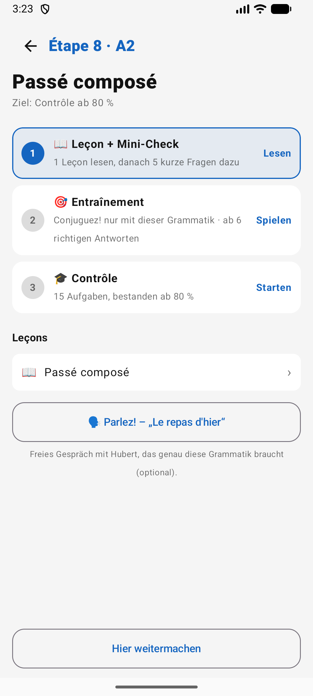
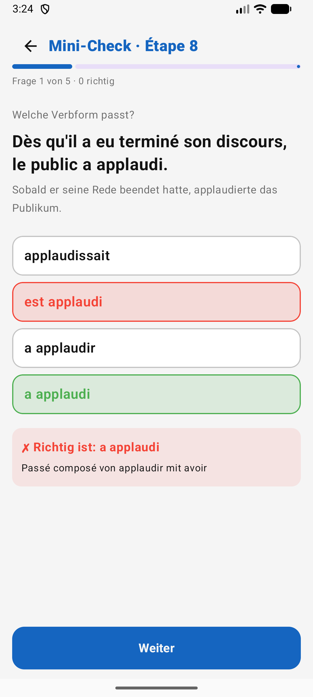
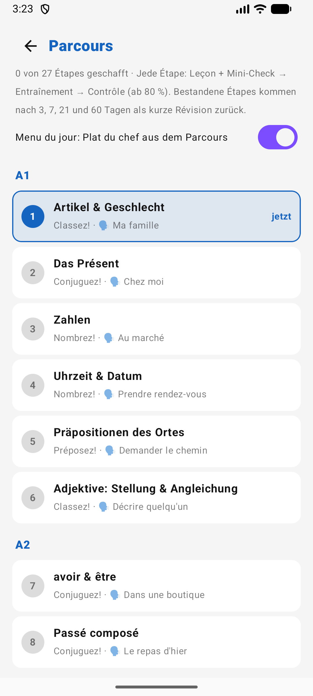
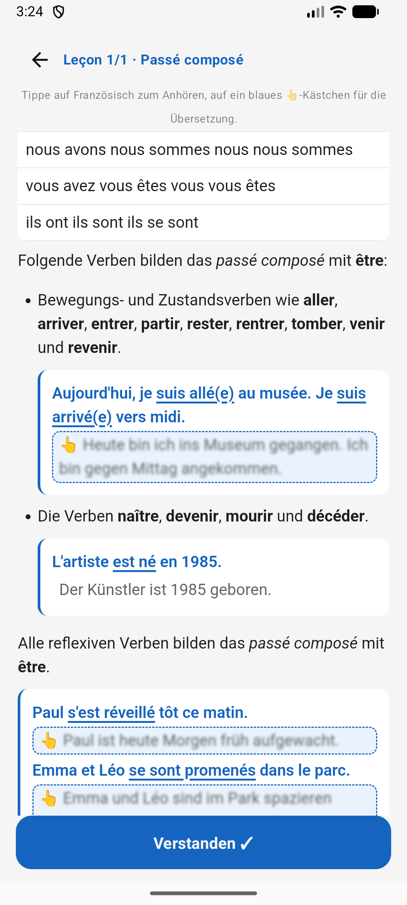
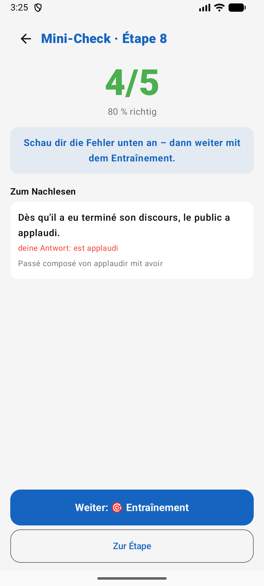
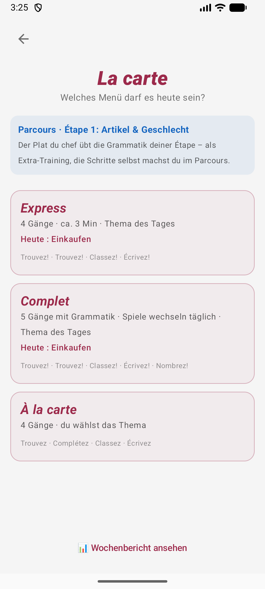

<div align="center">
  
  <h1>Hubert</h1>
  <p><strong>Learn French the playful way — a little every day.</strong><br>
  Vocabulary, grammar and speaking for German speakers, packed into quick games.</p>
  <p>
    <a href="https://github.com/florianow/hubert/releases/latest"></a>
    
    
    
  </p>
  <p>
    
    
    
  </p>
</div>

---

## Your day with Hubert

Open the app and the **Heute** tab tells you what's next — do it daily and your 🔥 streak grows:

1. **Vokabeln lernen** — today's words, in short game rounds instead of flashcards
2. **Menu du jour** — a few courses of games around one theme, graded like a French exam (out of 20)
3. **Parcours** — one step on your grammar path from A1 to B2

Everything else is free play: every game is always one tap away under **Spiele**.

## What's inside

### 🧠 Vocabulary that sticks
5000 most frequent French words with gender, pronunciation and example sentences. Every word has its own review schedule, like Anki — words you know drift away, words you miss come back tomorrow. Already using **AnkiDroid**? Hubert reads today's queue (read-only) and practises exactly those words in its games.

### 🧭 Parcours: grammar, step by step
27 étapes from *Artikel & Geschlecht* to *Subjonctif*. Each one is a short lesson, a mini-check, practice in the matching game and a final **Contrôle** — pass with 80 % and move on. Passed étapes come back as quick reviews after 3, 7, 21 and 60 days, so nothing gets lost.

### 🍽️ Menu du jour
Entrée, plat, fromage, dessert — a guided session of 4–5 games around today's theme (*Einkaufen*, *Reisen*, *Familie* …). At the end comes *l'addition*: your grade with a French *mention*, from *Passable* to *Félicitations du jury*.

### 🎮 11 games

| | Game | You … |
|---|---|---|
| 🔤 | **Trouvez!** | match French and German words against the clock |
| ⚖️ | **Classez!** | decide: *le* or *la*? |
| ✏️ | **Complétez!** | fill the gap in a real sentence |
| 👂 | **Écrivez!** | hear a word and type it |
| 🔁 | **Conjuguez!** | pick the right verb form, in 8 tenses |
| 📍 | **Préposez!** | choose the preposition: *à*, *de*, *en* … |
| 🔗 | **Relativisez!** | *qui*, *que*, *dont* or *lequel*? |
| 🎯 | **Accordez!** | agree the participle: *écrit* or *écrite*? |
| 🔢 | **Nombrez!** | master *quatre-vingt-dix-sept*, times and dates |
| 🎙️ | **Prononcez!** | read aloud and get a pronunciation score |
| 💬 | **Parlez!** | have a real conversation with Hubert — ordering at a café, at the doctor’s and ~80 more situations |

Prononcez! and Parlez! use Azure Speech and Google Gemini (bring your own free API keys, set in the app). Everything else works offline.

## Screenshots

<table>
  <tr>
    <td align="center"><br><b>Your daily plan</b></td>
    <td align="center"><br><b>Parcours A1–B2</b></td>
    <td align="center"><br><b>Leçon — tap 👆 for the German</b></td>
  </tr>
  <tr>
    <td align="center"><br><b>Mini-Check with the rule</b></td>
    <td align="center"><br><b>Your mistakes to read up on</b></td>
    <td align="center"><br><b>Menu du jour</b></td>
  </tr>
  <tr>
    <td align="center"><br><b>All games</b></td>
    <td align="center"><br><b>Trouvez!</b></td>
    <td align="center"><br><b>Conjuguez!</b></td>
  </tr>
  <tr>
    <td align="center"><br><b>Prononcez!</b></td>
    <td align="center"><br><b>Classez!</b></td>
    <td align="center"><br><b>Statistics</b></td>
  </tr>
</table>

## Get it

**[Download the latest APK](https://github.com/florianow/hubert/releases/latest)**, open it on your phone and allow installing from unknown sources. Android 8.0 or newer.

<details>
<summary><b>Build it yourself</b></summary>

You need Android Studio (or JDK 17 + Android SDK 26+).

```bash
git clone https://github.com/florianow/hubert.git
cd hubert
./gradlew installDebug    # build and install on a connected device
```

On macOS without a system JDK, use the one bundled with Android Studio:
`export JAVA_HOME="/Applications/Android Studio.app/Contents/jbr/Contents/Home"`
</details>

## Want the details?

How every game scores, how the review schedule and the Anki sync work, how the Parcours questions are built, the data pipeline, code structure and troubleshooting: **[docs/DETAILS.md](docs/DETAILS.md)**.

Built with Kotlin, Jetpack Compose and Material 3. Contributions welcome — fork, branch, pull request.

## Credits & license

Vocabulary, example sentences, conjugations and grammar lessons come from the wonderful [anki_french](https://github.com/jacbz/anki_french) deck by jacbz.

Licensed under the [GNU GPL v3.0](LICENSE).
