<div align="center">
  
  <h1>Hubert</h1>
  <p><strong>Gamified French-German vocabulary trainer with 8 game modes + guided Menu du jour</strong></p>
  <p>
    <a href="#features">Features</a> •
    <a href="#game-modes">Game Modes</a> •
    <a href="#getting-started">Getting Started</a> •
    <a href="#project-structure">Project Structure</a> •
    <a href="#data-pipeline">Data Pipeline</a> •
    <a href="#contributing">Contributing</a> •
    <a href="#license">License</a>
  </p>
  <p>
    
    
    
    
  </p>
</div>

---

## About

Hubert is a Duolingo-style Android app for learning French-German vocabulary through fast-paced mini-games. Built with Kotlin, Jetpack Compose, and Material Design 3, it features ~5000 vocabulary cards sourced from the [anki_french](https://github.com/jacbz/anki_french) Anki deck — including gender, IPA pronunciation, thematic categories, example sentences, and full verb conjugation tables across 8 tenses.

Three scoring systems keep things interesting:
- **Timer-based** (Trouvez!, Classez!, Complétez!, Écrivez!, Conjuguez!): Countdown timer with time bonuses for correct answers and penalties for wrong ones.
- **Points-based** (Prononcez!): Start with 10 points. Earn +3 per correct answer (plus streak bonus), lose 5 for each mistake — game over when you hit 0.
- **Evaluation-based** (Parlez!): After a 60-second free conversation, Gemini evaluates your performance across 5 categories (vocabulary, grammar, fluency, task completion, pronunciation) with a 0–100 overall score.

French words and sentences are spoken aloud via Android's built-in Text-to-Speech engine. Prononcez! uses Azure Speech Services to assess your pronunciation in real time, and Parlez! combines Azure STT with Google Gemini to enable free-form French conversations.

## Features

- **8 Game Modes** — Trouvez!, Classez!, Complétez!, Écrivez!, Conjuguez!, Prononcez!, Préposez!, Parlez!
- **Spaced repetition & learning path** — every vocab answer updates a per-word review schedule (Anki-style); new words arrive in frequency order (10/day); progress and an estimated level on the main menu
- **Daily reminder** — optional notification at a chosen hour when something is due and you haven't practised yet
- **Accordez!** — Past participle agreement (être, avoir + preceding object, reflexive verbs), with the rule explained after each answer
- **Nombrez!** — Numbers, clock times, dates, days and months (hear → type, plus multiple choice)
- **Menu du jour** — Guided multi-game session (Express, Complet, À la carte) around one theme, graded on the French /20 scale
- **5000 Vocabulary Cards** — sourced from a curated French Anki deck
- **IPA Phonetic Transcription** — shown alongside French words in Trouvez!, Classez!, and Conjuguez!
- **Pronunciation Assessment** — read French sentences aloud, scored by Azure Speech Services, with second-chance retry
- **Text-to-Speech** — hear correct French pronunciation after every correct answer
- **Streak System** — consecutive correct answers earn bonus points
- **High Scores** — per-game-type leaderboard stored locally
- **Statistics & Word Tracking** — per-word attempt tracking, "Words I Struggle With" section, achievements
- **28 Thematic Categories** — Tiere, Farben, Essen und Trinken, Familie, and more
- **3076 Nouns with Gender** — masculine/feminine data for Classez!
- **~2000 Example Sentences** — real French sentences with German translations for Complétez!
- **1182 Verbs with Conjugations** — full conjugation tables across 8 tenses for Conjuguez!
- **Adaptive Difficulty** — Prononcez! adjusts sentence length based on your streak; Conjuguez! error-weights tenses you struggle with; Parlez! topics span CEFR levels A1–B2
- **Tense Info with Limits** — Conjuguez! shows grammar info dialogs with conjugation tables; limited to 3 views per tense per round with timer pause
- **Manual Advance** — Conjuguez! and Prononcez! wait for you to tap "Next" instead of auto-advancing
- **Offline-first** — all data bundled as JSON assets, no network required (except Prononcez! which uses Azure Speech Services, and Parlez! which uses both Azure and Gemini)
- **Material Design 3** — clean, modern UI with themed game colors

## Game Modes

The start screen has three tabs (bottom navigation): **Heute** — the plan of the day: ① *Vokabeln lernen* (today's due words) → ② *Menu du jour* (theme of the day), each with its status (due count / "✓" with the menu's grade out of 20) and a 🔥 streak of days in a row with practice; **Spiele** — every game, free to play; **Fortschritt** — known/learning words, estimated level, streak, weekly report and per-game statistics.

### Spaced repetition & learning path

Every answer in Trouvez!, Classez!, Complétez! and Écrivez! updates a per-word schedule (`word_progress`, `utils/SpacedRepetition.kt`, unit-tested), SM-2 style as in Anki:

- **Correct** → the interval grows (1 → ~3 → ~8 → ~20 days …). Typing the word (Écrivez!) counts as *recall* and grows faster than *recognition* (matching, choosing). Practising early doesn't inflate the interval; remembering a word after an overdue gap counts part of the extra time.
- **Wrong** → back to 1 day, the word gets harder (ease −0.2).
- At most one step per word and day — five correct answers in one round are one review.
- A word is **sicher** once its interval reaches 3 weeks.

**Learning path:** new words are introduced in frequency order, 10 per day, in the *Amuse-bouche* at the start of Express/Complet (word, article/gender, IPA, translation, example sentence, audio; "Kenne ich schon" schedules a check in a week). Menu courses use new words, due reviews and recent mistakes first, the theme of the day fills the rest. Free play in the vocab games also puts due and learned words first. **Vokabeln lernen** (main menu, or tapping "heute fällig") works through today's due words in rounds (with the Anki sync: today's Anki queue — new, learning and review cards within the deck's limits — taken read-only at 4:30 each morning and on app start, so it is still known after the cards were done in Anki; a word is done once answered right in Hubert); the stages take turns (starting with the one with the most due words, so a small stage is not starved), each with its games — *erkennen* (interval < 3 days): Trouvez! / **Écoutez!** (hear → pick the meaning), *im Satz* (3–10 days): Complétez! / **Dites!** (rebuild the sentence, ★ = target), *abrufen* (10+ days): **Rappel** (see the German meaning → type the French word; article and accents optional) / Dites!. After each round it shows what is still due. "Fertig für heute" ends with a short *Bilan du jour*: words practised, accuracy, minutes, how many of today's due words are done, results per game and the words still wrong at the end (*À revoir*).

**Progress:** the main menu shows known / learning / due today and a rough vocabulary level (A1 ≈ 500, A2 ≈ 1000, B1 ≈ 2000, B2 ≈ 4000 known words). On first start after the update, past answers are replayed once to seed the schedule; the resulting backlog is spread over two weeks.

**Anki (read-only)** (Einstellungen → Mit Anki abgleichen): reads the player's AnkiDroid deck through AnkiDroid's public ContentProvider (`AnkiRepository`, permission `com.ichi2.anki.permission.READ_WRITE_DATABASE`, but Hubert only reads). Cards are matched to Hubert's words by the deck's rank field (the vocab comes from the same anki_french deck). Words started in Anki join Hubert's learning path (spread over a week), words Anki keeps for 3+ weeks get at least Anki's interval in Hubert, and Hubert stops introducing new words itself — Anki stays the place for deep learning, Hubert reinforces it in games. Runs on app start and via "Jetzt abgleichen". Nothing is ever written to Anki.

**Daily review limit** (Einstellungen → Wiederholungen pro Tag: 50 / 100 / 150 / 200 / unbegrenzt, default 150): "heute fällig" only counts what still fits into today's limit (only reviews of words that were due count against it — filler and free-play words don't); the rest stays due and moves up on the next days, most overdue and frequent first. Vokabeln lernen offers "Trotzdem weiter" once the limit is reached.

**Daily reminder** (Einstellungen): optional notification at a chosen hour, only if no round was played that day and something is due (WorkManager).

### Menu du jour

A guided learning session that chains several games into one "menu", built around a thematic category plus words you recently struggled with (and pinned words). The courses follow a learning progression — recognise → apply in context → grammar → consolidate gender → produce — and words missed in earlier courses come back in later ones.

| Menu | Part 1 · your words | Part 2 · theme |
|---|---|---|
| **Express** | Apéritif (Trouvez!) | Entrée (Trouvez!) · Dessert (Écrivez!) · alternating daily: Fromage (Classez!) or Café (Nombrez!) — theme picked by Hubert |
| **Complet** | Apéritif (Trouvez!) | Entrée (Trouvez!) · Plat du chef (grammar) · 2 of Complétez! / Classez! / Écrivez! / Nombrez!, a different pair each day — 5 courses in total |
| **À la carte** | — | Entrée (Trouvez!) · Plat principal (Complétez!) · Fromage (Classez!) · Dessert (Écrivez!) — you choose the theme |

Part 1 uses only the learning path (new words of the day, due reviews, recent mistakes, then learned words); part 2 only the theme, starting with a Trouvez! round to get to know the theme words. Mistakes come back within the same part. **With the Anki sync there is no part 1** — your own words come from the deck and are worked through in *Vokabeln lernen* — so the menu is all theme: Express Entrée · Plat (Complétez!) · Dessert · Fromage or Café, Complet Entrée · Plat du chef · 3 of the rotation.

Course lengths: Trouvez! 40s, Complétez! 45s, Classez! 30s, Écrivez! 45s, grammar 60s, Nombrez! 45s. The *Plat du chef* is the grammar game you need most — Conjuguez!, Préposez!, Relativisez! or Accordez! — never the same as the previous Complet, otherwise the one with the lowest accuracy over the last 4 weeks; inside the game it focuses on your most-missed tenses/prepositions/pronouns. Conjuguez! always uses 3 tenses: up to 2 most-missed ones, topped up with the core tenses (présent, passé composé, imparfait, futur, conditionnel, subjonctif) practised least lately. In Classez! the menu balances le/la 50/50, topping up the theme with nouns from outside it, since many themes are gender-skewed (e.g. Berufe).

**L'addition** grades the menu: each course scores 0–100 (80% accuracy + 20% volume), the average becomes a grade out of 20 with a French *mention* (Passable, Assez bien, Bien, Très bien, Félicitations du jury). It compares against your last menu of the same type, lists missed words under *À revoir* with a pin button, and shows grammar mistakes with the correct answer. Menus are stored in the `menu_sessions` table; the individual games still record their normal sessions and statistics.

### Dites! (round in Vokabeln lernen)

Built on the anki_french **Lückenspiel**, but graded by the game instead of self-rating — Anki stays the place for the full card routine. The front shows a deck example sentence with the target word underlined; the sentence in the other language (DE → FR or FR → DE, alternating) is rebuilt by tapping alphabetically sorted word tiles in order, the target word being the ★ tile (`utils/ClozeGame.kt`, unit-tested). Result per card: **richtig** (no wrong tile, no hint) · **noch wacklig** (found with mistakes or hints) · **falsch** (target revealed or "Auflösen"); ⚡ (only the target left) is not counted as a hint. Afterwards: word, meaning and the French sentence with audio, plus optional speaking with an Azure score (not graded). Uses the deck's example sentences (`examples.json`, up to 20 per word, built by `scripts/build_examples.py`). In Vokabeln lernen Dites! alternates with Complétez! (*im Satz*) and with Rappel (*abrufen*).

### Accordez!

Past participle agreement — pick the correctly agreed form (écrit / écrite / écrits / écrites). After each answer the full sentence and the rule are shown. Questions are generated from curated patterns (`AccordezQuestionGenerator`, unit-tested):

| Rule | Example |
|---|---|
| être → agrees with the subject | Marie est **partie** · Julie et Marc sont **arrivés** · Madame, vous êtes **venue** |
| avoir, object after → no agreement | Nous avons **écrit** la lettre. |
| avoir, object before (que / l' / les) | Voici la lettre que j'ai **écrite**. · Les photos ? Elle les a **prises**. |
| reflexive, se = direct object | Elle s'est **levée** tôt. |
| reflexive, object after / se = indirect | Elle s'est **lavé** les mains. · Ils se sont **parlé**. |

- **Scoring**: 150 pts + streak bonus · **Timer**: 60s, +3s correct, -5s wrong

### Nombrez!

Numbers, clock times and dates — the classic hurdle for German speakers (soixante-dix-sept, quatre-vingt-dix-sept, trois heures moins le quart). Pick topics on the selection screen; questions are mixed:

| Topic | Question |
|---|---|
| Zahlen bis 100 | Hear a number, type the digits — half of the questions from 70–99 |
| Zahlen bis 1000 / Große Zahlen & Jahre | Hear → type (1990, 250 300, …) |
| Uhrzeit | Read « trois heures moins le quart » → pick 2:45; hear « quatorze heures trente-sept » → pick 14:37 |
| Datum | Hear « le quinze août » → pick 15.08. |
| Tage & Monate | Translate, or pick the day/month that comes next |

All questions are generated in code (`utils/FrenchNumbers.kt`, unit-tested) — no data file. Distractors are built from typical confusions (hour ±1, et ↔ moins, treize/quatorze/quinze/seize).

- **Scoring**: 100 pts (choice) / 150 pts (typed) + streak bonus
- **Timer**: 60s, +3s correct, -5s wrong

### 1. Trouvez!

Match French words on the left with their German translations on the right. Four pairs are shown at a time — tap a French word, then tap its German match. Matched pairs are replaced immediately so the game flows continuously. IPA phonetic transcription is shown on each French card.

- **Scoring**: 100 pts per match + streak bonus
- **Timer**: 40s, +5s for clearing the board, -2s wrong

### 2. Classez!

A French noun appears on screen with its IPA transcription — tap whether it takes the masculine article (**le**) or the feminine article (**la**). Only pure nouns are included (no verbs, pronouns, or adjectives that happen to have a grammatical gender).

- **Scoring**: 100 pts per correct + streak bonus
- **Timer**: 60s, +2s correct, -5s wrong
- **Pool**: ~2100 nouns with known gender

### 3. Complétez!

A French sentence is shown with one word blanked out. The German translation is displayed as a hint. Pick the correct word from 4 choices — distractors are drawn from the same thematic category as the answer (e.g., if the answer is "chat", other options come from the "Tiere" category).

- **Scoring**: 150 pts per correct + streak bonus
- **Timer**: 60s, +2s correct, -5s wrong
- **Pool**: ~2000 words with example sentences

### 4. Écrivez!

Hear a French word spoken via TTS, then type it. The German translation is shown as a hint. Accents are forgiven — "cafe" matches "café".

- **Scoring**: 200 pts per correct + streak bonus
- **Timer**: 60s, +2s correct, -5s wrong
- **Pool**: all 5000 words

### 5. Conjuguez!

A verb conjugation challenge. Before the game starts, you choose which tenses to practice (Présent, Imparfait, Futur, Conditionnel, Subjonctif, Passé simple, Impératif, Passé composé). During gameplay, tenses are picked randomly from your selection with error-weighted repetition — tenses you get wrong appear more frequently.

When a matching example sentence exists in the dataset, you see a French sentence with the verb blanked out, plus the German translation as context. Otherwise, a plain drill card shows the infinitive (with IPA transcription) and subject pronoun. Pick the correct conjugated form from 4 choices — distractors are other forms of the same verb (different tenses or persons). Passé composé has two question types that alternate: auxiliary selection (avoir/être) and verb form selection. When both **Subjonctif** and **Présent** are selected, a special mood-recognition question fires ~25% of the time: a sentence is shown and you must decide whether it takes the subjonctif or the indicatif based on the trigger phrase (e.g. *il faut que* → subjonctif, *je sais que* → indicatif). Tap the tense name to see a grammar info dialog with German explanations, examples, and conjugation formation tables (limited to 3 views per tense per round — timer pauses while viewing, lock icon shown when exhausted). After answering, tap "Next" to advance manually.

- **Scoring**: Timer-based — 90s countdown, +5s correct, -5s wrong, 300s cap. 150 pts per correct + 30 per streak level
- **Pool**: 1182 verbs across 8 tenses (Présent, Imparfait, Futur, Conditionnel, Subjonctif, Passé simple, Impératif, Passé composé)

### 6. Préposez!

A French sentence is shown with the preposition blanked out. The German translation is shown as a hint. Pick the correct preposition from 4 choices — covering à, de, en, dans, sur, avec, sans, par, pour, avant, après, entre, contre, sous, vers, chez.

- **Scoring**: 150 pts per correct + streak bonus
- **Timer**: 60s, +5s correct, -5s wrong
- **Pool**: 764 sentences extracted from [anki_french](https://github.com/jacbz/anki_french) preposition cards

### 8. Parlez!

A free-form French conversation mode. Choose a topic from ~80 everyday scenarios (ordering at a café, asking for directions, visiting the doctor, etc.) spanning CEFR levels A1–B2. Each topic shows a German scenario description and Hubert's role (waiter, pharmacist, receptionist, etc.). Hubert opens with a French starter sentence, then you have 60 seconds to converse back and forth — speak into the microphone, Azure transcribes and scores your pronunciation per word, Gemini generates Hubert's contextual reply, and the conversation continues until time runs out.

After the timer expires, Gemini evaluates your entire conversation across 5 categories:

| Category | What it measures |
|----------|-----------------|
| **Wortschatz** | Vocabulary range and appropriateness |
| **Grammatik** | Grammatical accuracy |
| **Flüssigkeit** | Conversational fluency and natural flow |
| **Aufgabe** | How well you completed the scenario task |
| **Aussprache** | Pronunciation (based on Azure word-level scores) |

Each category receives a score from 0–100 with a short German explanation, plus an overall weighted score. Words you mispronounced (accuracy < 80%) are listed separately.

- **Scoring**: Evaluation-based — 5 categories scored 0–100, weighted overall score
- **Timer**: 60s conversation window
- **Topics**: ~80 scenarios across CEFR A1–B2
- **Requires**: Azure Speech Services API key + Google Gemini API key (both configured in-app via settings)

### 7. Prononcez!

Read French sentences aloud and get scored on your pronunciation by Azure Speech Services. A reference sentence is displayed (French + German translation), you record yourself reading it, and Azure returns a pronunciation score with per-word accuracy feedback. Words you mispronounced are highlighted in the results. After each attempt, you can compare your pronunciation to the correct one — tap "Correct" to hear the sentence via TTS, or "Yours" to play back your own recording. Tap "Next" to advance manually.

Difficulty adapts to your streak: short sentences at first (Facile, <= 6 words), medium sentences as you improve (Moyen, 7-10 words), and long sentences at high streaks (Difficile, 11+ words).

**Second chance**: If you score 80-94 on your first attempt, you get a retry — tap "TRY AGAIN" to re-record the same sentence at a lower pass threshold of 85. Score below 80 and it's an immediate fail; score 95+ and it's an immediate pass.

- **Scoring**: Points-based — start with 10 pts, +3 correct + streak bonus, -5 wrong, game over at 0
- **Pass threshold**: PronScore >= 95 (first attempt), >= 85 (second attempt)
- **Retry range**: PronScore 80-94 on first attempt earns a second chance
- **Requires**: Azure Speech Services API key (configured in-app via settings dialog)
- **Game over stats**: Average/best/worst pronunciation scores, most mispronounced words

## Tech Stack

- **Language**: Kotlin
- **UI**: Jetpack Compose with Material Design 3
- **Architecture**: MVVM (Model-View-ViewModel)
- **Dependency Injection**: Hilt
- **Database**: Room (high scores, game sessions, word attempts)
- **Preferences**: Jetpack DataStore (Azure API settings)
- **JSON Parsing**: Gson
- **Text-to-Speech**: Android TTS (French locale)
- **Pronunciation Assessment**: Azure Speech Services REST API
- **Conversational AI**: Google Gemini 2.5 Flash (conversation partner + evaluation in Parlez!)
- **Audio Recording**: Android AudioRecord (16 kHz, 16-bit, mono PCM → WAV)
- **Asynchronous**: Kotlin Coroutines & Flow
- **Build**: Gradle (Kotlin DSL)
- **CI/CD**: GitHub Actions (automatic APK builds on tag push)
- **Data Pipeline**: Python (YAML parsing, HTML scraping)

## Screenshots

<table>
  <tr>
    <td align="center">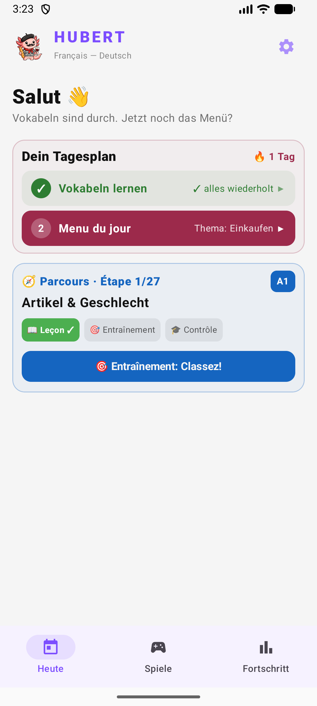<br><b>Main Menu</b></td>
    <td align="center">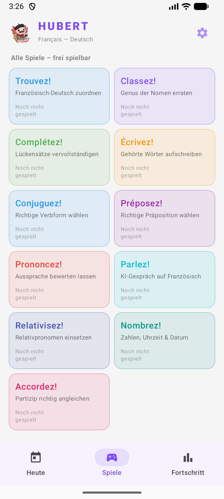<br><b>All 8 Game Modes</b></td>
    <td align="center">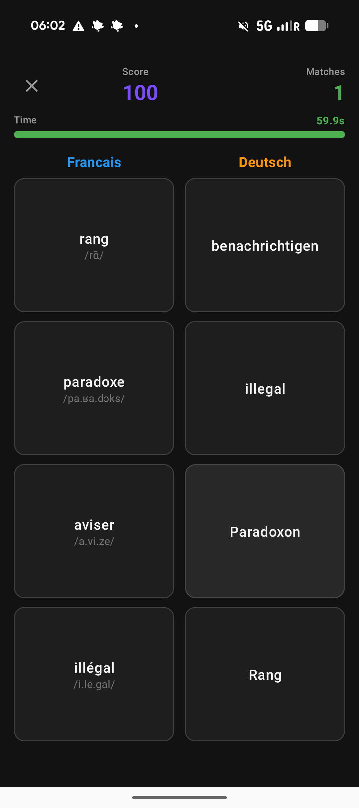<br><b>Trouvez!</b></td>
  </tr>
  <tr>
    <td align="center">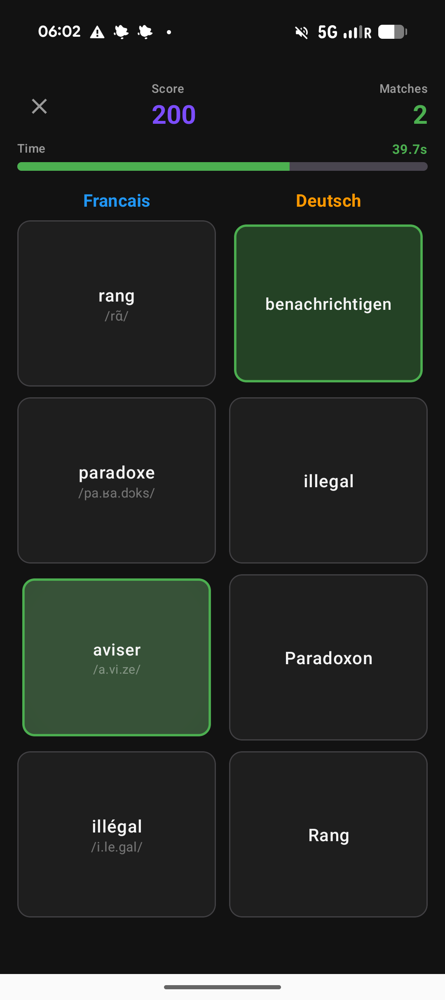<br><b>Trouvez! — Correct</b></td>
    <td align="center">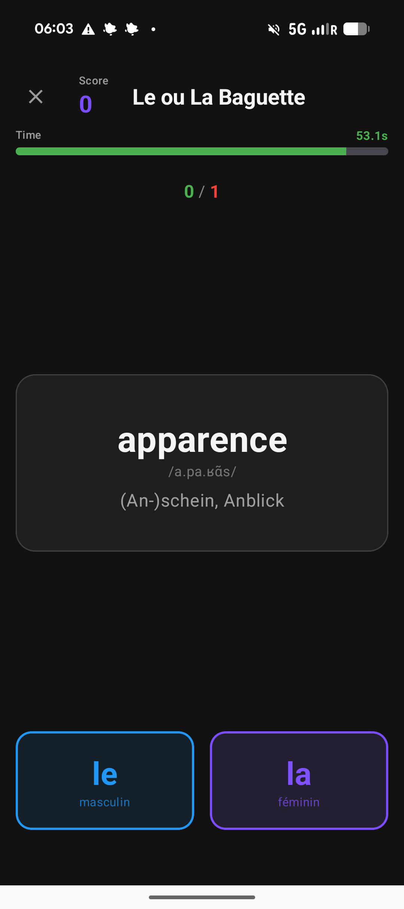<br><b>Classez!</b></td>
    <td align="center">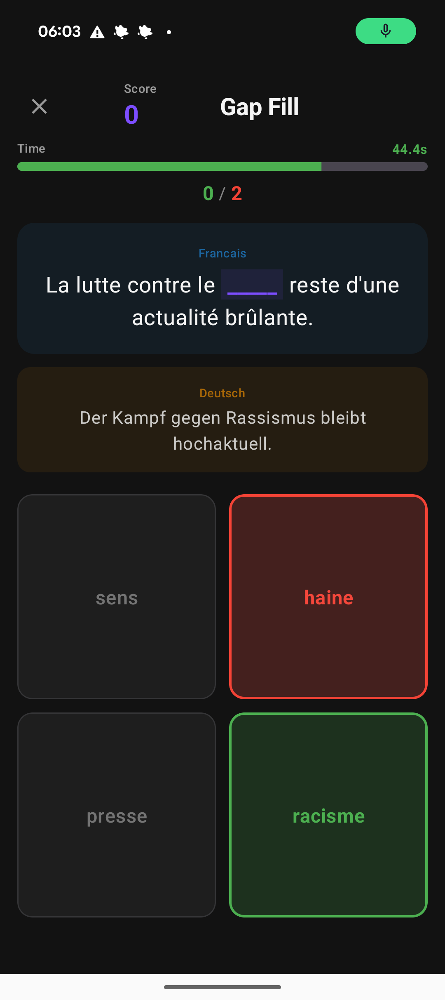<br><b>Complétez!</b></td>
  </tr>
  <tr>
    <td align="center">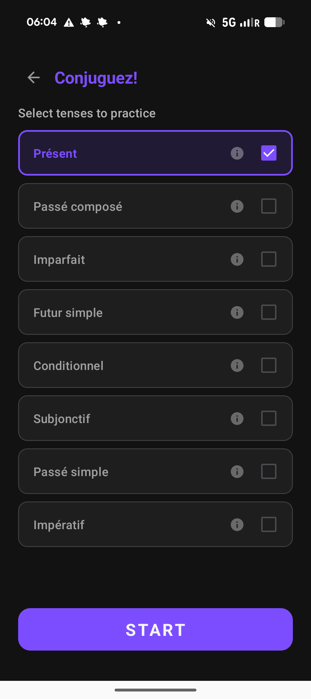<br><b>Conjuguez! — Tense Selection</b></td>
    <td align="center">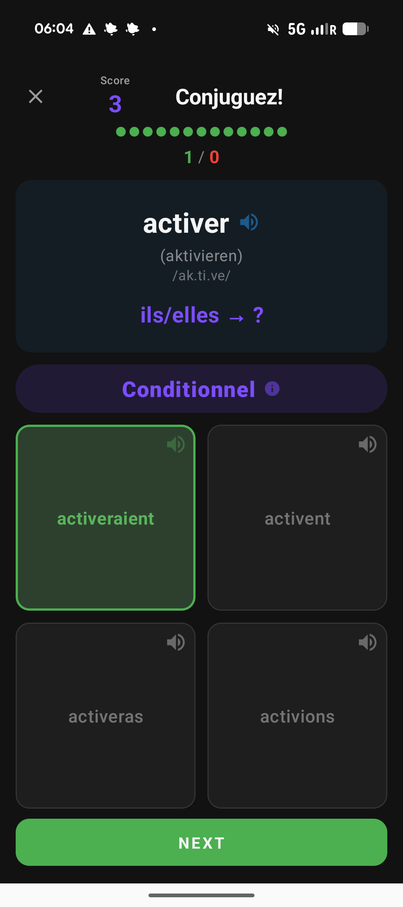<br><b>Conjuguez! — Gameplay</b></td>
    <td align="center">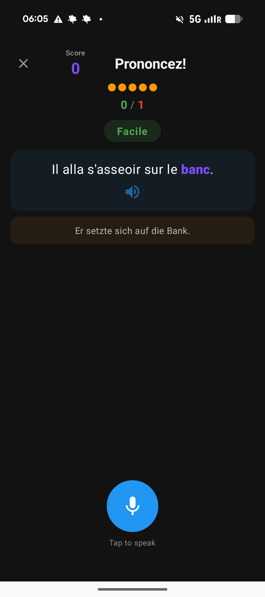<br><b>Prononcez! — Ready</b></td>
  </tr>
  <tr>
    <td align="center">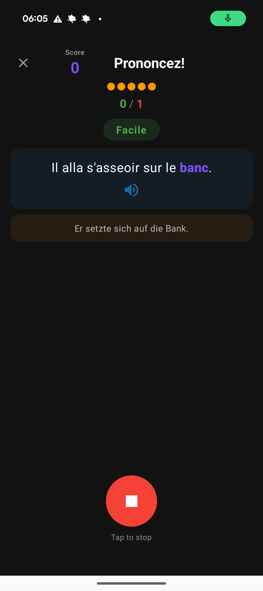<br><b>Prononcez! — Recording</b></td>
    <td align="center">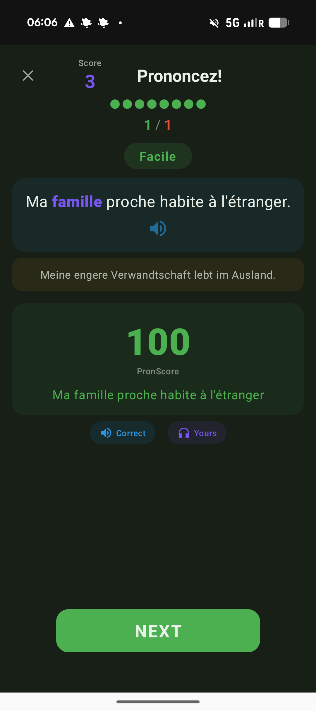<br><b>Prononcez! — Correct (100)</b></td>
    <td align="center">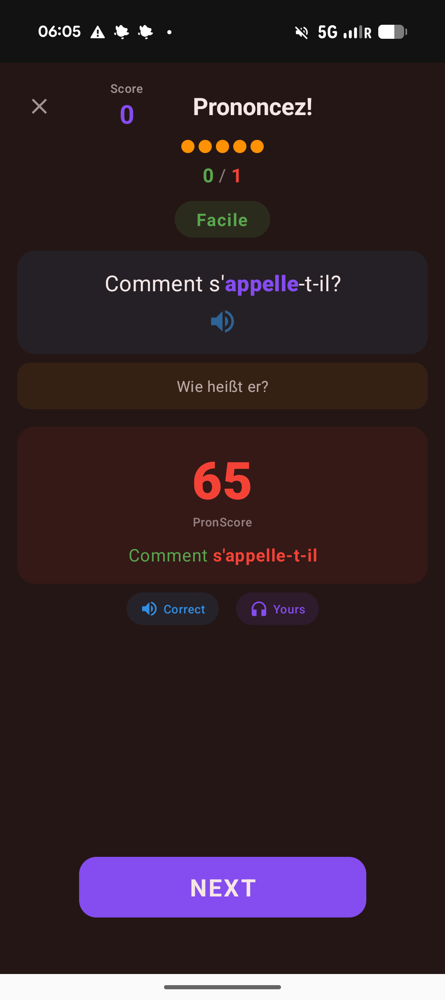<br><b>Prononcez! — Wrong (65)</b></td>
  </tr>
  <tr>
    <td align="center">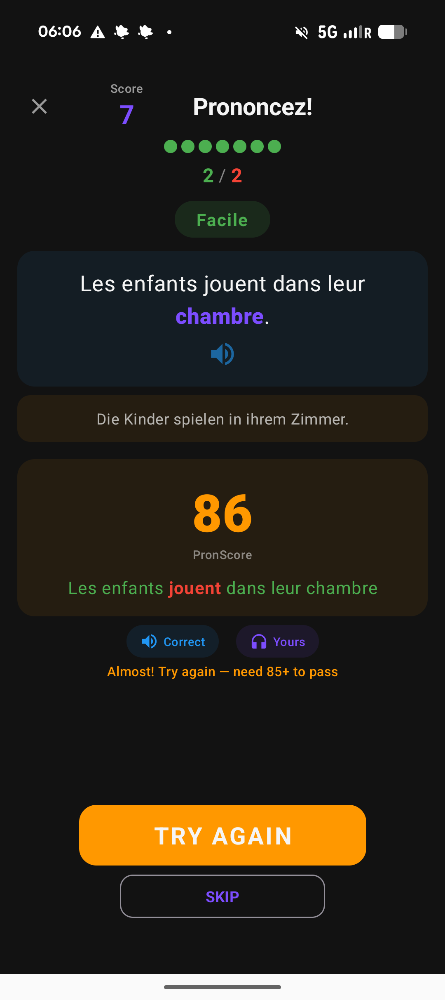<br><b>Prononcez! — Second Chance</b></td>
    <td align="center">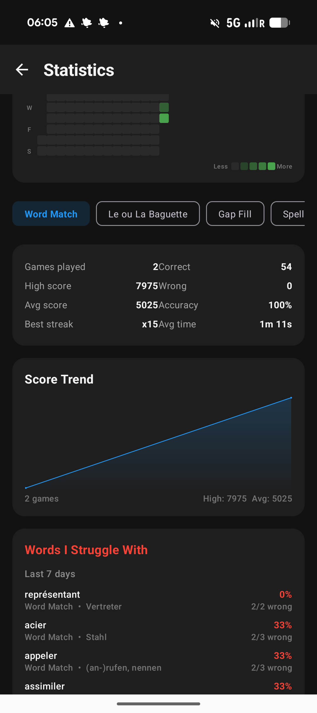<br><b>Statistics & Score Trend</b></td>
    <td align="center">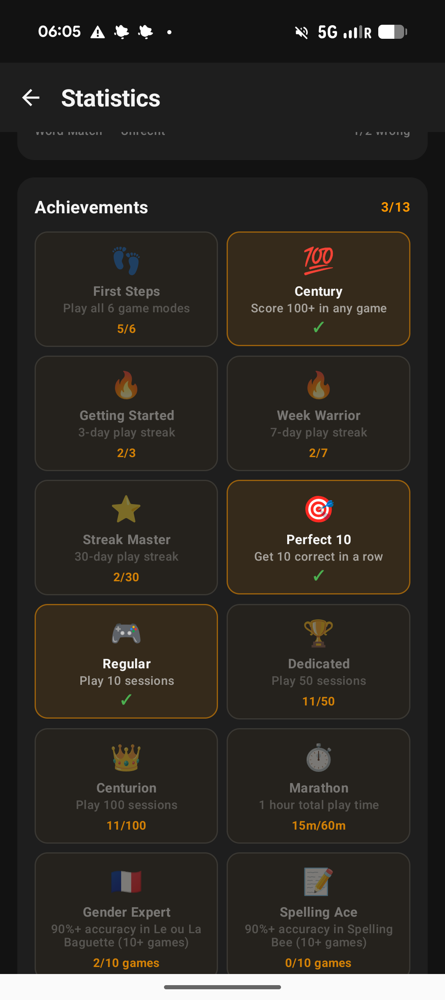<br><b>Achievements</b></td>
  </tr>
</table>

## Getting Started

### Download Pre-built APK

1. Go to [Releases](https://github.com/florianow/hubert/releases)
2. Download the latest `hubert-*.apk`
3. Transfer to your Android device
4. Enable "Install from Unknown Sources" in Settings
5. Open the APK and install

### Prerequisites (for building from source)

- Android Studio (latest version recommended)
- Android SDK 26+ (Android 8.0 Oreo or higher)
- JDK 17 or higher
- Python 3 (only needed to regenerate vocabulary data)

### Building the App

#### Option 1: Using Android Studio (Recommended)

1. Clone the repository:
```bash
git clone https://github.com/florianow/hubert.git
cd hubert
```

2. Open the project in Android Studio:
   - File → Open → Select the project folder
   - Wait for Gradle sync to complete
   - Click Run or press `Shift+F10`

#### Option 2: Using Command Line

**On macOS:**

```bash
git clone https://github.com/florianow/hubert.git
cd hubert

# Build the debug APK (using Android Studio's bundled JDK)
export JAVA_HOME="/Applications/Android Studio.app/Contents/jbr/Contents/Home"
./gradlew assembleDebug
```

**On Linux/Windows:**

```bash
./gradlew assembleDebug
```

**Build Output:**
- The APK will be at: `app/build/outputs/apk/debug/app-debug.apk`

#### Option 3: Install to Connected Device/Emulator

```bash
./gradlew installDebug
```

## Data Pipeline

The vocabulary data is sourced from the [anki_french](https://github.com/jacbz/anki_french) repository and converted into JSON asset files by Python scripts. Conjugation data is extracted from the Anki deck's `.apkg` database.

### Running the Vocabulary Pipeline

```bash
python3 scripts/convert_vocab.py
```

This downloads the YAML card data and parses the thematic category HTML files, producing:

| File | Contents | Size |
|------|----------|------|
| `app/src/main/assets/vocab.json` | 5000 words with rank, french, german, gender, IPA, part of speech, categories | ~535 KB |
| `app/src/main/assets/categories.json` | 28 thematic categories → list of word rank numbers | ~12 KB |
| `app/src/main/assets/sentences.json` | ~2000 words → up to 5 example sentences each (French + German + blank word) | ~1.4 MB |

### Running the Conjugation Pipeline

```bash
python3 scripts/extract_conjugations.py
```

This reads the local Anki database (requires the "Französisch 5000" deck imported in Anki), parses HTML conjugation tables, matches example sentences to conjugated forms, and produces:

| File | Contents | Size |
|------|----------|------|
| `app/src/main/assets/conjugations.json` | 1182 verbs with conjugation forms across 8 tenses + matched example sentences | ~3.2 MB |

### Data Fields

Each vocabulary word includes:

- **rank** — frequency rank (1–5000)
- **french** — French word
- **german** — German translation
- **gender** — `"m"` (masculine) or `"f"` (feminine), null if not a noun
- **ipa** — IPA pronunciation
- **pos** — part of speech (`nm`, `nf`, `vt`, `vi`, `adj`, `adv`, etc.)
- **categories** — list of thematic categories the word belongs to

## Project Structure

```
app/src/main/java/com/hubert/
├── data/
│   ├── local/
│   │   ├── AppDatabase.kt          # Room database (v4, high scores + sessions + word attempts)
│   │   ├── HighScoreDao.kt         # Per-game-type score queries
│   │   ├── GameSessionDao.kt       # Game session history queries
│   │   └── WordAttemptDao.kt       # Per-word attempt tracking queries
│   ├── model/
│   │   ├── VocabWord.kt            # VocabWord, SentenceEntry, ConjugationVerb data classes
│   │   ├── ParlezTopic.kt          # ParlezTopic data class (topic, scenario, role, CEFR level)
│   │   ├── HighScore.kt            # Room entity with gameType field
│   │   ├── GameSession.kt          # Room entity for game session history
│   │   └── WordAttempt.kt          # Room entity for per-word attempt tracking
│   └── repository/
│       ├── VocabRepository.kt      # Vocab, categories, sentences, conjugations, IPA lookup
│       ├── HighScoreRepository.kt  # Save/query scores by game type
│       ├── StatisticsRepository.kt # Game sessions, word attempts, achievements
│       └── SettingsRepository.kt   # DataStore-backed API key storage (Azure + Gemini)
├── di/
│   └── DatabaseModule.kt           # Hilt module (Room + TTS singletons)
├── ui/
│   ├── screens/
│   │   ├── MenuScreen.kt           # Main menu with Menu du jour + game mode cards
│   │   ├── TrouvezScreen.kt        # Trouvez! game UI (with IPA on French cards)
│   │   ├── ClassezScreen.kt        # Classez! game UI (with IPA)
│   │   ├── CompletezScreen.kt      # Complétez! game UI
│   │   ├── EcrivezScreen.kt        # Écrivez! game UI
│   │   ├── ConjuguezScreen.kt      # Conjuguez! game UI (with IPA, timer, info limits)
│   │   ├── PrononcezScreen.kt      # Prononcez! game UI (recording, word-level feedback, retry)
│   │   ├── PreposezScreen.kt       # Préposez! game UI
│   │   ├── ParlezScreen.kt         # Parlez! game UI (topic selection, conversation, evaluation)
│   │   ├── GameOverScreen.kt       # Generic game over screen (with answer history detail)
│   │   ├── StatisticsScreen.kt     # Statistics, achievements, words I struggle with
│   │   ├── HighScoresScreen.kt     # Top 10 high scores list
│   │   └── SettingsScreen.kt       # Global API key settings (Azure Speech + Google Gemini)
│   └── theme/
│       ├── Color.kt                # FrenchBlue, GermanGold, AccentPurple, etc.
│       └── Theme.kt                # Material 3 theme configuration
├── utils/
│   ├── FrenchTts.kt                # Text-to-Speech wrapper (French locale)
│   ├── AzurePronunciationApi.kt    # Azure Speech Services REST client
│   ├── GeminiApi.kt                # Google Gemini REST client (chat + evaluation)
│   └── AudioRecorder.kt            # PCM audio capture → WAV byte array
├── viewmodel/
│   ├── TrouvezViewModel.kt         # Trouvez! game logic
│   ├── ClassezViewModel.kt         # Classez! game logic
│   ├── CompletezViewModel.kt       # Complétez! game logic
│   ├── EcrivezViewModel.kt         # Écrivez! game logic
│   ├── ConjuguezViewModel.kt       # Conjuguez! game logic (8 tenses, timer, IPA, info limits)
│   ├── PrononcezViewModel.kt       # Prononcez! game logic (Azure, adaptive difficulty, second chance)
│   ├── PreposezViewModel.kt        # Préposez! game logic
│   ├── ParlezViewModel.kt          # Parlez! game logic (Gemini conversation, Azure STT, evaluation)
│   ├── StatisticsViewModel.kt      # Statistics and achievements
│   ├── SettingsViewModel.kt        # Settings logic (read/write API keys via SettingsRepository)
│   └── AnswerRecord.kt             # Per-question answer log for detail views
├── HubertApplication.kt            # Hilt application class
└── MainActivity.kt                 # Entry point, screen navigation

scripts/
├── convert_vocab.py                # Data pipeline: YAML + HTML → JSON assets
├── extract_conjugations.py         # Conjugation pipeline: Anki DB → conjugations.json
└── extract_prepositions.py         # Preposition pipeline: anki_french YAML → prepositions.json

app/src/main/assets/
├── vocab.json                      # 5000 vocabulary words
├── categories.json                 # 28 thematic categories
├── sentences.json                  # ~2000 words with example sentences
├── conjugations.json               # 1182 verbs with conjugation tables + sentence matches
└── prepositions.json               # 764 preposition fill-in-the-blank sentences (16 prepositions)
├── parlez_topics.json              # ~80 conversation topics with scenarios, roles, CEFR levels
```

## Architecture

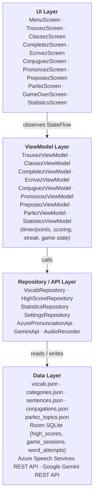

**Data flow:** User taps answer → UI calls ViewModel → ViewModel checks answer, updates score/timer/streak → StateFlow emits new state → Compose redraws UI.

## Troubleshooting

### Build fails with "Unable to locate a Java Runtime"

Use Android Studio's bundled JDK:
```bash
export JAVA_HOME="/Applications/Android Studio.app/Contents/jbr/Contents/Home"
./gradlew assembleDebug
```

### Build fails with "SDK location not found"

Create `local.properties` in the project root:
```properties
sdk.dir=/Users/YOUR_USERNAME/Library/Android/sdk
```

### No French speech / TTS not working

- Make sure a French TTS voice is installed: Settings → Accessibility → Text-to-Speech → Install French language pack
- Check device volume is not muted

### Database errors after updating

The app uses `fallbackToDestructiveMigration()` — if the database schema changes, it will be recreated automatically. High scores will be lost on schema updates during development.

### Prononcez! — "Assessment failed" error

- Make sure you have a working internet connection — Prononcez! requires network access to Azure Speech Services
- Check that your Azure Speech API key and region are correctly configured (tap the settings icon in the main menu)
- You can get a free Azure Speech Services key at [Azure Portal](https://portal.azure.com/) (free tier: 5 hours/month)

### Prononcez! — recording not working

- Grant the microphone permission when prompted (Settings → Apps → Hubert → Permissions → Microphone)
- Make sure no other app is using the microphone

### Parlez! — conversation not working

- Parlez! requires both an **Azure Speech Services API key** (for speech-to-text + pronunciation) and a **Google Gemini API key** (for conversation + evaluation). Configure both via the settings icon in the main menu.
- Get a free Gemini API key at [Google AI Studio](https://aistudio.google.com/apikey)
- If Hubert's replies seem truncated, check your Gemini API quota — Parlez! uses Gemini 2.5 Flash
- If words are getting cut off during recording, make sure you wait a moment after finishing your sentence before the recording stops

## Contributing

Contributions are welcome!

1. Fork the repository
2. Create a feature branch (`git checkout -b feature/amazing-feature`)
3. Commit your changes (`git commit -m 'Add amazing feature'`)
4. Push to the branch (`git push origin feature/amazing-feature`)
5. Open a Pull Request

### Ideas for Contributions

- Add more game modes (sentence ordering, listening comprehension, etc.)
- Difficulty levels (filter by word frequency rank)
- Daily challenges / spaced repetition
- Dark mode support
- Localization (English hints instead of German)
- Sound effects and animations
- Accessibility improvements

## License

This project is licensed under the GNU General Public License v3.0 - see the [LICENSE](LICENSE) file for details.

## Acknowledgments

- Vocabulary and conjugation data from [anki_french](https://github.com/jacbz/anki_french) by jacbz
- Built with Kotlin and Jetpack Compose
